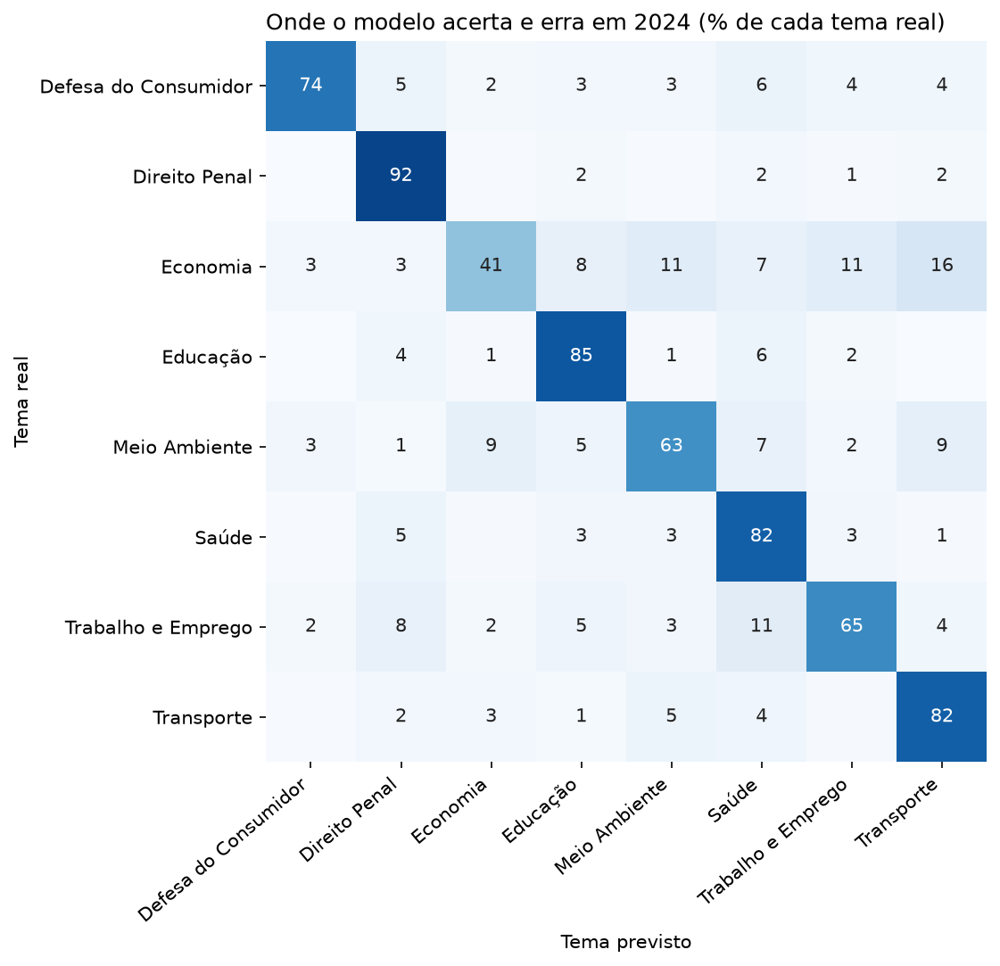

# Classificador de projetos de lei

Modelo de linguagem natural que indica o tema de um projeto de lei a partir da ementa, usando dados abertos da Câmara dos Deputados.

**Resultado principal:** treinando só com projetos de 2023, o modelo acertou 76,5% dos projetos de 2024, contra 19,6% de escolher sempre o maior tema.



## Principais resultados

| Métrica no teste (2024) | Modelo | Referência |
| --- | --- | --- |
| Acurácia | 76,5% | 19,6% |
| F1 macro | 0,730 | 0,041 |

| Tema | F1 |
| --- | --- |
| Direito Penal | 0,876 |
| Saúde | 0,808 |
| Educação | 0,802 |
| Defesa do Consumidor | 0,750 |
| Transporte | 0,743 |
| Trabalho e Emprego | 0,708 |
| Meio Ambiente | 0,667 |
| Economia | 0,486 |

## O que este projeto mostra

- **Validação honesta:** com divisão aleatória, o F1 macro seria 0,802. Em um ano novo, foi 0,730. A separação no tempo mostra o desempenho que se pode esperar de verdade.
- **Sem vazamento:** o modelo foi escolhido só com dados de 2023, e 45 ementas repetidas foram removidas.
- **Erros explicáveis:** Economia tem o pior resultado, e um dos seus termos mais fortes é "rota turística", sinal de que a categoria mistura assuntos.

## Como foi feito

1. Coleta de 5.197 projetos de lei de 2023 e 2024, em 8 temas, com [`coletar.py`](coletar.py).
2. Representação do texto com TF-IDF de palavras e pares de palavras.
3. Comparação de Naive Bayes, SVM linear e regressão logística com validação cruzada em 2023.
4. Teste único em 2024 e análise dos erros em [`analise.ipynb`](analise.ipynb).

## Como rodar

```bash
pip install -r requirements.txt
jupyter notebook analise.ipynb
```

Para classificar uma ementa nova:

```bash
python classificar.py "Dispõe sobre a vacinação gratuita contra a dengue em escolas públicas."
```

```text
Educação: 35%
Saúde: 19%
Direito Penal: 8%
```

Nesse exemplo, a ementa cabe em dois temas e o modelo escolhe um deles. As porcentagens servem para ordenar os temas, e não são probabilidades calibradas.

`dados/projetos_de_lei.csv` já vem no repositório. Rodar `python coletar.py` baixa os dados de novo, e os números podem mudar.

## Limites

- O modelo só conhece 8 temas e usa projetos com um único tema entre eles, o que deixa a tarefa mais fácil do que a classificação completa da Câmara.
- Parte dos termos mais fortes são números de leis, que funcionam melhor com leis já citadas no treino.
- Naive Bayes, SVM e regressão logística ficaram muito próximos, então a escolha não prova que um modelo é melhor em geral.

Desenvolvido com apoio do Claude Code.
